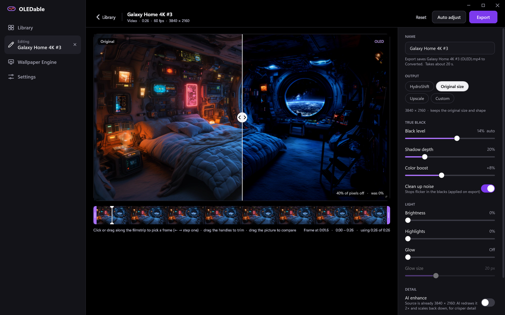
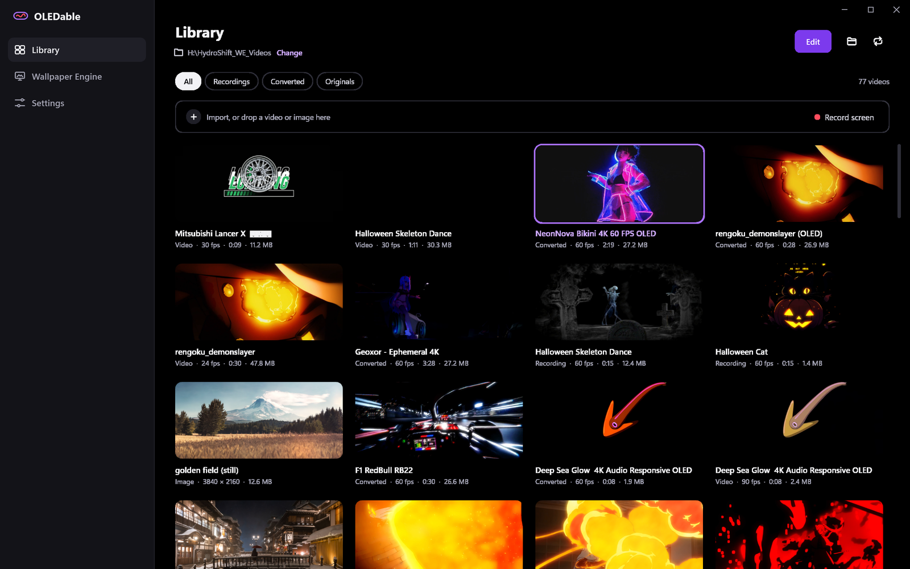
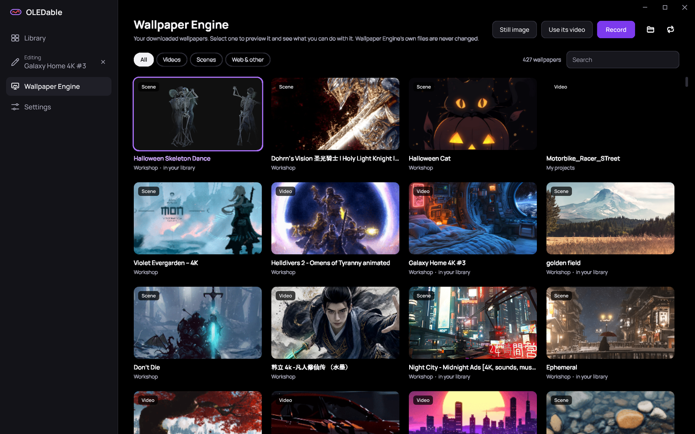
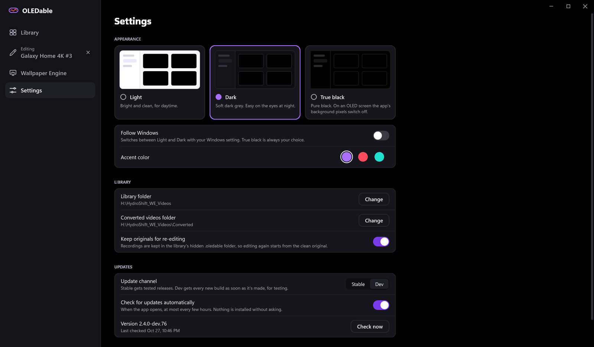

# OLEDable

A Windows app that makes any wallpaper, video or still, look its best on an **OLED screen**. Hazy, grey blacks become **true black**, so those pixels switch fully off, and everything else is yours to tune: shadows, color, brightness, highlights and glow. Then upscale it with AI, smooth it to 60 fps, and fit it to any screen.

https://github.com/user-attachments/assets/fcb76644-4d7a-4c6a-9b09-eeed251895c5

*Left: the original. Its "black" sky is really a dark purple, so every pixel stays lit (0% off). Right: after OLEDable, 60% of the pixels switch fully off.*

> **Work in progress.** A personal hobby project, shared as-is. Things may change between versions, and bug reports are answered when time allows.

## Install

Download `OLEDable-Setup-x.y.z.exe` from [Releases](../../releases) and run it. It installs for your user only (no admin prompt), and the uninstaller never touches your library.

- **Express** sets everything up for you and downloads the tools it needs.
- **Advanced** lets you choose the library folder and each tool.

**Needs:** Windows 10 or 11. AI enhance and 60 fps smoothing need a GPU with Vulkan (any recent NVIDIA, AMD or Intel). ffmpeg 8 or newer is recommended for recording Wallpaper Engine scenes.

## Features

- **True black:** a live before/after preview. The black level is detected for each video, and shadows, color, brightness, highlights and glow can be fine-tuned.
- **Wallpaper Engine:** browse every wallpaper you've downloaded. Videos import in one click; scenes give up their video or background image, or are recorded as a video. Wallpaper Engine's own files are never changed.
- **AI enhance:** Real-ESRGAN redraws small or soft wallpapers at a higher resolution.
- **Smooth to 60 fps:** RIFE adds real in-between frames to lower frame-rate videos.
- **Any size:** keep the original, upscale 2× or 4×, or fill a size you choose (4K, ultrawide, phone…).
- **Seamless loops:** the end crossfades into the start.
- **Record a screen:** capture any monitor, with a live preview.
- **Videos and images:** MP4, MKV, WebM… and PNG, JPEG, WebP, BMP, TIFF.
- Light, dark and true-black themes, and updates from inside the app.

## Screenshots



| Library | Wallpaper Engine |
| --- | --- |
|  |  |



## For the Lian Li HydroShift

OLEDable started as **HydroShift Recorder** for the Lian Li HydroShift II OLED Curved AIO screen. Pick the **HydroShift** output size and it makes a 2288 × 1048 video under L-Connect's 30 MB limit; upload it as a custom theme in L-Connect 3 and the screen plays it on its own.

## Privacy

No telemetry, accounts or analytics. The app only goes online to check this repository for updates (can be turned off) and to download its tools from their official pages when needed: [ffmpeg](https://www.gyan.dev/ffmpeg/builds/), [RIFE](https://github.com/nihui/rife-ncnn-vulkan/releases), [Real-ESRGAN](https://github.com/xinntao/Real-ESRGAN/releases) and [RePKG](https://github.com/notscuffed/repkg/releases). Settings and edits stay on your PC.

## Build it yourself

Every push to `main` is built by GitHub Actions and published as a Dev pre-release. Locally, with the .NET 8 SDK:

```
build.cmd             # app → dist\OLEDable.exe
build-installer.cmd   # installer → dist-installer\ (needs Inno Setup 6.6+)
```

## Credits

[RIFE / rife-ncnn-vulkan](https://github.com/nihui/rife-ncnn-vulkan) (MIT) · [Real-ESRGAN](https://github.com/xinntao/Real-ESRGAN) (BSD-3-Clause) · [RePKG](https://github.com/notscuffed/repkg) (MIT) · [FFmpeg](https://ffmpeg.org) (LGPL/GPL, downloaded separately) · [Inno Setup](https://jrsoftware.org/isinfo.php) · [Manrope](https://github.com/sharanda/manrope) font (SIL OFL)

Not affiliated with Lian Li or Wallpaper Engine. "HydroShift" and "L-Connect" are Lian Li's product names.

## License

[MIT](LICENSE)
